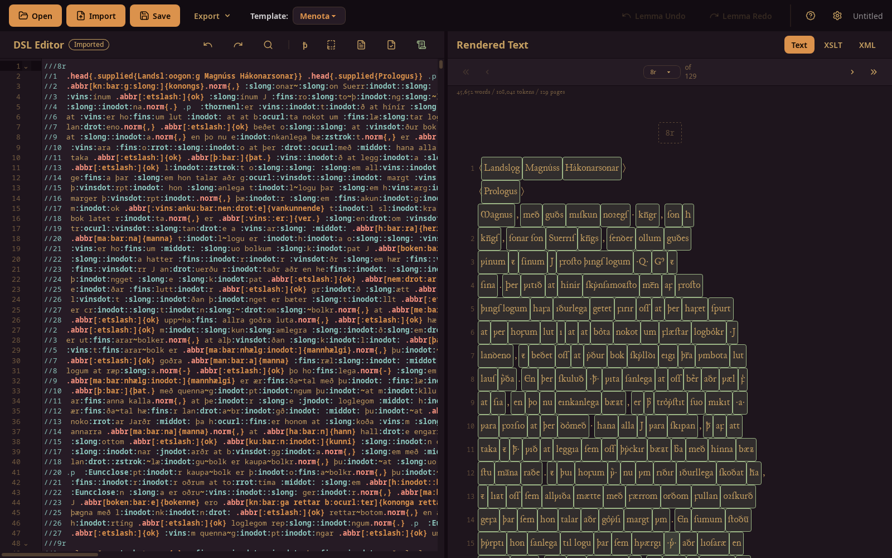

<p align="center">
  
</p>

<h1 align="center">Saga-Scribe</h1>

<p align="center">
  Manuscript transcription in TEI-XML, with support for MENOTA.
</p>

<p align="center">
  <a href="https://github.com/motheatensoul/saga-scribe/releases/latest"></a>
  <a href="https://github.com/motheatensoul/saga-scribe/actions/workflows/release.yml"></a>
  <a href="LICENSE"></a>
</p>

Saga-Scribe is a desktop application for transcribing manuscripts into TEI-XML, intended for
textual scholars preparing digital editions. Transcriptions are entered in a plain-text
shorthand, from which the application generates the corresponding TEI markup. It supports
the encoding recommendations of the [Medieval Nordic Text Archive (MENOTA)](https://www.menota.org/)
and was developed with Old Norse material in mind, though the shorthand itself is not
specific to any language.

**Status:** beta, version 0.8.0. Saga-Scribe is usable for full-length manuscripts, but
features and the interface may still change between versions. Projects saved with older
versions remain loadable. Please [report problems to the issue tracker](https://github.com/motheatensoul/saga-scribe/issues).



## Overview

General-purpose XML editors such as Oxygen can produce any TEI document, but the encoder
writes the markup directly, so line breaks, abbreviations and word boundaries all appear as
nested elements around the transcribed text. Saga-Scribe separates the two: the text is
entered with a small set of inline markers, and the XML structure is derived from them.

### Transcription shorthand

The shorthand is written line by line and has no nesting to keep track of. Line and page
breaks, abbreviations, gaps, supplied text, deletions, additions and unclear readings each
have their own marker. For example, the line

```
///1r //1 Hér hefr upp sǫgu .abbr[kgs]{konungs} ?{Haralds}? ins hár~//2fagra [...3<ok>] -{hans}- +{sona}+
```

is compiled to

```xml
<pb n="1r"/>
<lb n="1"/>
<w>Hér</w>
<w>hefr</w>
<w>upp</w>
<w>sǫgu</w>
<w><choice><abbr>kgs</abbr><expan>konungs</expan></choice></w>
<w><unclear>Haralds</unclear></w>
<w>ins</w>
<w>hár<lb n="2"/>fagra</w>
<w><gap reason="illegible" quantity="3" unit="chars"/><supplied>ok</supplied></w>
<w><del>hans</del></w>
<w><add>sona</add></w>
```

Word division is handled by the application, including words broken across a line or page
(`hár~//2fagra`). Each word becomes a `<w>` element that can be lemmatized or annotated.
A [summary of the shorthand](#shorthand-reference) is given below.

### Preview and export

The editor is shown alongside a preview that is updated during transcription. The preview
can display the reading text, the generated XML, or the result of applying an XSLT
stylesheet to it, so that a project's own stylesheet can be used to check the text as it
will appear in the edition. Documents can be exported as TEI-XML, or, through the
stylesheet, as HTML and PDF.

The compiled document can be validated against the TEI P5 schema (`tei_all`) and the
MENOTA P5 schema from within the application.

### Lemmatization and annotation

Words are lemmatized by selecting them in the preview. Lemmas and morphological analyses
(MENOTA `me:msa`) can be looked up in the
[Dictionary of Old Norse Prose (ONP)](https://onp.ku.dk/) or entered by hand, and analyses
are remembered for later occurrences of the same form. Notes and other annotations can be
attached to individual words or characters. Annotations are stored separately from the
transcription, which therefore stays readable.

### MENOTA

From a single transcription, Saga-Scribe can produce the facsimile, diplomatic and
normalized levels of a MENOTA transcription (`<me:facs>`, `<me:dipl>`, `<me:norm>`).
Special characters are entered as MENOTA/MUFI entities (`:name:`); a searchable list of
about 2,000 of them is included, and they are displayed in the
[Junicode](https://junicode.sourceforge.io/) font. Further entities can be defined per user.

### Existing TEI files

TEI-XML files can be opened and edited in the shorthand. When such a file is saved, only
the passages that were edited are rewritten; the rest of the file, including markup the
shorthand cannot express, is preserved byte for byte.

## Getting started

### Install

Download the latest version from the
[releases page](https://github.com/motheatensoul/saga-scribe/releases/latest):

| System                | File                                                              |
| --------------------- | ----------------------------------------------------------------- |
| Windows               | `…_x64-setup.exe` or `…_x64_en-US.msi`                            |
| macOS (Apple silicon) | `…_aarch64.dmg`                                                   |
| macOS (Intel)         | `…_x64.dmg`                                                       |
| Linux                 | `.flatpak` (recommended), `.AppImage`, `.deb` (Debian/Ubuntu) or `.rpm` (Fedora/openSUSE) |

> [!NOTE]
> **The builds are not code-signed yet**, so your system will warn you the first time you
> open Saga-Scribe:
>
> - **Windows:** SmartScreen shows "Windows protected your PC". Click **More info**, then
>   **Run anyway**.
> - **macOS:** macOS says the app "cannot be opened" or "is damaged". Either open
>   **System Settings → Privacy & Security** and click **Open Anyway**, or run
>   `xattr -dr com.apple.quarantine "/Applications/Saga Scribe.app"` in Terminal.
> - **Linux:** install the Flatpak with `flatpak install --user saga-scribe-*.flatpak`
>   (its GNOME runtime comes from [Flathub](https://flathub.org/setup)), or make the
>   AppImage executable with `chmod +x` and run it.
> **Note that when working on institutional hardware, you will almost certainly not have permission to install untrusted software. Please communicate with your IT-department and have them review the app/code. A web-based version of the app is under consideration for hosting within institutions.**

Want to try what's coming next? The
[nightly build](https://github.com/motheatensoul/saga-scribe/releases/tag/nightly) is made
every night from the version in development. Expect potentially unfinished features or file-breaking bugs. **Do not use with original project files, always edit a copy when testing an in-development build!**

### First steps

1. Choose a template in the toolbar. Templates set the TEI header and whether words and
   MENOTA levels are written out.
2. Type your transcription in the editor on the left; the preview on the right follows.
3. Click a word in the preview to lemmatize or annotate it.
4. Save your work as a project (`.teis`): it keeps the transcription, lemmas and
   annotations together.
5. Export TEI-XML, HTML or PDF from the **File** menu.

Press **F1** in the app for the shorthand reference and keyboard shortcuts. The
[user guide](docs/user-guide.md) covers everything in detail.

### Shorthand reference

| You type                 | Meaning                                    | TEI                                                      |
| ------------------------ | ------------------------------------------ | -------------------------------------------------------- |
| `//` or `//3`            | Line break (optionally numbered)           | `<lb/>`, `<lb n="3"/>`                                   |
| `///1v`                  | Page break                                 | `<pb n="1v"/>`                                           |
| `//{56r}`, `///{fol. 1r}` | Break number with letters or spaces       | `<lb n="56r"/>`, `<pb n="fol. 1r"/>`                     |
| `.p`                     | New paragraph (on its own)                 | `</p><p>`                                                |
| `.abbr[kgs]{konungs}`    | Abbreviation with its expansion            | `<choice><abbr>…</abbr><expan>…</expan></choice>`        |
| `[...]` or `[...3]`      | Gap, optionally with its length in letters | `<gap reason="illegible" quantity="3" unit="chars"/>`    |
| `[...3<ok>]`             | Gap with supplied text                     | `<gap …/><supplied>ok</supplied>`                        |
| `<text>`                 | Supplied text (may contain shorthand)      | `<supplied>text</supplied>`                              |
| `-{text}-`               | Deletion                                   | `<del>text</del>`                                        |
| `+{text}+`               | Addition                                   | `<add>text</add>`                                        |
| `?{text}?`               | Unclear reading                            | `<unclear>text</unclear>`                                |
| `^{text}`                | Note                                       | `<note>text</note>`                                      |
| `:name:`                 | Special character (MENOTA/MUFI entity)     | `&name;`                                                 |
| `#.x.#`                  | Numeral                                    | `<num>.x.</num>`                                         |
| `ꝼæ\;ðꝛ`                 | Character as text, part of the word        | `<w>ꝼæ;ðꝛ</w>`                                           |
| `hár~//2fagra`           | Word continues over a line (`~///` page)   | `<w>hár<lb n="2"/>fagra</w>`                             |
| `upp~haf`                | One word written as two                    | `<w>upp haf</w>`                                         |
| `\|`                     | Word boundary with no space                |                                                          |

## Building from source

You need [bun](https://bun.sh/), [Rust](https://rustup.rs/) (with rustup, the pinned
toolchain in `rust-toolchain.toml` is installed automatically) and the system libraries
Tauri needs ([Tauri prerequisites](https://v2.tauri.app/start/prerequisites/)), plus libxml2:

- **Debian/Ubuntu:**
  `sudo apt install libwebkit2gtk-4.1-dev libappindicator3-dev librsvg2-dev patchelf libxml2-dev`
- **macOS:** `brew install libxml2`, then
  `export PKG_CONFIG_PATH="$(brew --prefix libxml2)/lib/pkgconfig"`
- **Windows:** libxml2 via vcpkg, as in
  [`.github/actions/setup-libxml2-windows`](.github/actions/setup-libxml2-windows/action.yml)

Then:

```bash
git clone https://github.com/motheatensoul/saga-scribe
cd saga-scribe
bun install
bun run tauri dev      # run the app in development mode
bun run tauri build    # build installers into src-tauri/target/release/bundle/
```

To build the Flatpak, run `flatpak/build-flatpak.sh`. It compiles the app inside the GNOME
SDK rather than on your system.

Before opening a pull request, run the tests and checks:

```bash
bun run test        # frontend (Vitest) and Rust tests
bun run check:all   # svelte-check and cargo clippy
```

With [Nix](https://nixos.org/) (flakes enabled), `nix develop` gives a shell with bun, the
pinned Rust toolchain and the system libraries, on Linux and Apple Silicon macOS; run
`bun install` and the commands above in it.

Saga-Scribe is written in Svelte 5 and TypeScript (frontend, with CodeMirror 6 as the
editor) and Rust (the shorthand compiler, TEI import and everything else on the backend),
using Tauri 2. See [CONTRIBUTING.md](CONTRIBUTING.md) for the project layout and
conventions.

## Contributing

Contributions are welcome, from bug reports and feature requests to code. Please read
[CONTRIBUTING.md](CONTRIBUTING.md) and our [Code of Conduct](CODE_OF_CONDUCT.md).
Changes between versions are listed in the [changelog](CHANGELOG.md).

## AI assistance

Saga-Scribe is developed with the help of [Claude Code](https://claude.com/claude-code).
Commits made with it carry a `Co-Authored-By: Claude` line.

## License

Saga-Scribe is licensed under the [GNU General Public License v3.0 or later](LICENSE).
It bundles fonts, data and libraries by others; see
[THIRD_PARTY_LICENSES.md](THIRD_PARTY_LICENSES.md) for their licences.

Many thanks and appreciation to Robert K. Paulsen of MENOTA and the UiB University Library, whose [Menota Blitz](https://legacy.emroon.no/MenotaBlitz.html) application and personal insight have been a major inspiration in the creation of the project!

Made with love in Norway.
